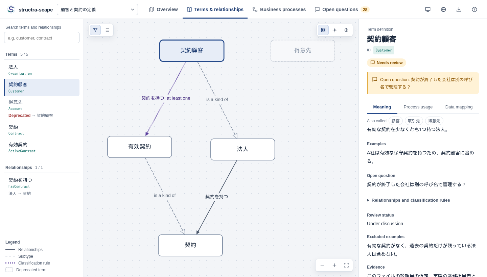
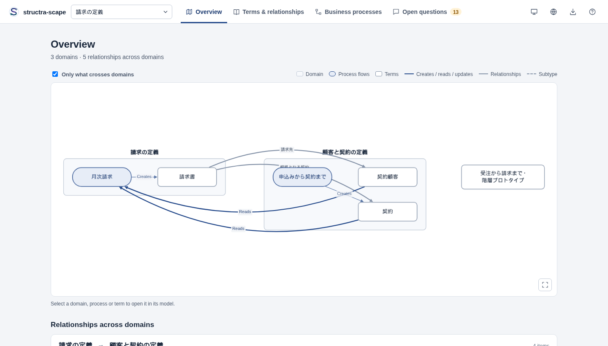
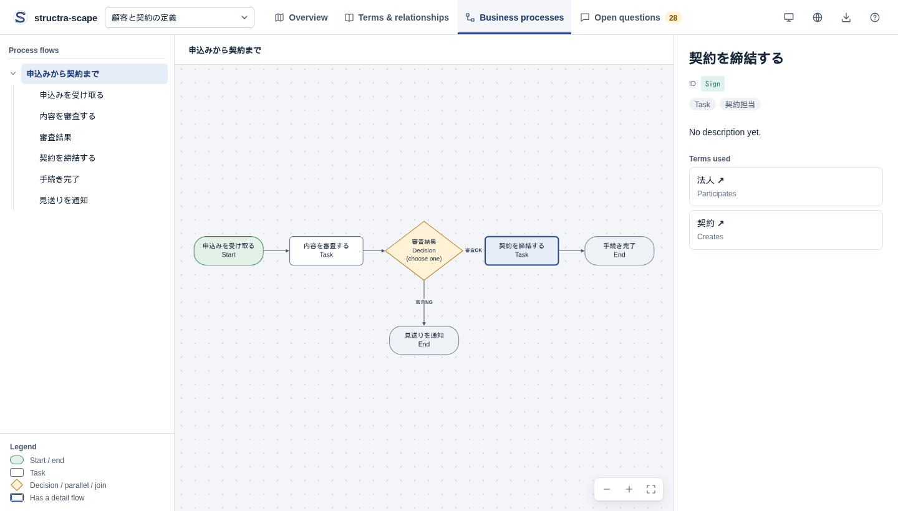
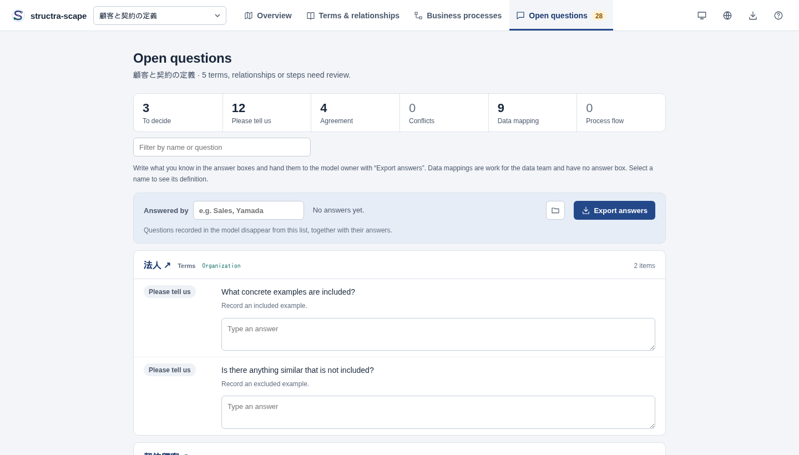

<h1 align="center">
   structra-scape
</h1>

<p align="center"><a href="README.md">日本語</a> | English</p>

`structra-scape` (CLI: `strscape`) helps business users and data teams agree on how their work flows and what their words mean. An AI agent (Claude Code or Codex) writes the model as YAML; people read it in a single self-contained HTML viewer.

- **Terms and relationships**: definitions, aliases, included and excluded examples, evidence and agreement state; how terms relate and the rules that classify them
- **Attributes (data items)**: the values a term carries (dates, amounts, codes…) and where they live in the data
- **Business processes**: steps in order, who does them, and the terms each step uses, with drill-down into detail flows
- **Open questions**: what is missing, undecided, not yet agreed or not yet mapped to data, and gaps in the flows (owners, decision conditions, dead ends), phrased as questions business users can answer in the viewer
- **Changes**: how the meaning changed since the last commit, with changes to agreed definitions highlighted

The YAML is the source of truth. The viewer is read-only; the model is changed by the AI or in a text editor.



| Overview | Business processes | Open questions |
|---|---|---|
|  |  |  |

The viewer's menus and guidance switch between Japanese (the default) and English. Model text — term names, definitions, questions — is shown as written and never translated; the samples are written in Japanese.

## Install

Requires Node.js 22 or later.

```bash
npm install -g structra-scape
# before the package is published to npm
npm install -g github:yujikawa/structra-scape
```

## Getting started

Run `strscape init` in your project. It creates `models/business.yaml` and installs the modeling skill for Codex and Claude Code.

```text
project/
  models/business.yaml
  models/README.md                            # how to read the models (for AIs handed the YAML)
  .agents/skills/strscape-modeling/SKILL.md   # Codex
  .claude/skills/strscape-modeling/SKILL.md   # Claude Code
```

Open a new AI session and ask: `$strscape-modeling organize our contract intake` (Codex) or `/strscape-modeling organize our contract intake` (Claude Code). The AI reads the existing `models/`, extends a model for related work or creates a new domain file such as `models/contracts.yaml`, and asks when the boundary is unclear.

```bash
strscape dev models/                   # preview at http://127.0.0.1:4173; reloads when the YAML is saved
strscape build models/ --output dist   # one self-contained HTML file to share
```

- `init --codex` / `init --claude` installs only one skill; `--no-skills` creates only the YAML. Existing YAML is never overwritten.
- Add another domain with `strscape init models/contracts.yaml --no-skills`.
- `models/README.md` tells an AI that is handed only the YAML how to read it (agreed vs. draft, how to read classification rules, what to do when an imported file is missing). Share it with `models/`. Create it for an existing folder with `strscape guide --read > models/README.md`.
- Add the skill to an existing project with `strscape skills` (`--directory <folder>`, `--agent codex|claude|both`). Customized skill files are never overwritten unless you pass `--force`.

## Starting from what you already have

### A glossary spreadsheet

Save the glossary as CSV (or TSV) and give it to the AI. Following the skill, the AI adds an English ID column and imports it:

```bash
strscape import-glossary glossary-with-ids.csv > patch.json   # reads term, definition, synonyms, parent, source… columns
strscape apply models/business.yaml --patch patch.json --dry-run
```

- Headers are recognized in English or Japanese (`name` / `用語`, `description` / `定義`, `aliases` / `同義語`, `parent` / `上位語`, `evidence` / `出典`, …).
- Rows without an ID, or with a duplicate one, are refused. The CLI never invents IDs.
- An "approved" column is never imported as `agreed`: the AI confirms with you that the agreement still stands. Columns that were not imported are listed in `warnings`.

### Checking data mappings against the schema

Check that the tables and columns named in `data_mapping` exist:

```bash
strscape check-mapping models/ --schema target/catalog.json --format md   # dbt catalog.json or manifest.json
strscape check-mapping models/ --schema columns.csv                       # a CSV export of information_schema.columns
```

- The exit code is 1 when a table or column is missing, so it works in CI.
- Only names are checked. Whether the data means what the business definition says (`verified`) is for the data team to confirm.

## The viewer

The header switches models (when a folder is built) and views. Tool buttons (export, help, language, color scheme, diagram controls, the *Show* range…) are icons; hover for their names. View tabs and *Export answers* keep their text. Business users and the data team use the same view: IDs and data mappings are always visible.

| View | Shows |
|---|---|
| Overview | The entry point when several models are built together. Each domain is a box with its processes and terms; lines show what crosses domains. Below: relationships per pair of domains, a terms-by-process table, and questions across domains |
| Terms & relationships | The relationship diagram and the definitions list. A term's detail has Meaning, Process usage and Data mapping tabs. Search covers names, IDs, aliases and attribute names |
| Business processes | The flow diagram and the process tree; move from a step to the terms it uses and back |
| Open questions | Open items grouped by term and step, each with an answer box (except data-mapping work) |
| Changes | Under `dev`, changes since git `HEAD` by default (`--compare <revision>` / `--no-compare`); in `build`, only with `--compare <revision>` |

- **Large models**: the diagram's *Show* control narrows the view to the selected term and its neighbours (or two steps away); selecting a neighbour re-centres on it. Models with more than 40 terms open this way. In Open questions, the count tiles filter by kind and a search box filters by name or question. A workspace of 7 domains, ~400 terms and 30 flows switches views in under a second (`tests/fixtures/large-workspace.js`).
- The page reloads when the YAML changes, keeping the view, selection and zoom. Invalid YAML keeps the last valid view and shows the error.
- The color-scheme button in the header picks System, Light or Dark (icons; System follows the OS and is the default). The choice is remembered in the browser. Diagrams keep a light sheet in dark mode. Printing gives the open view as a clean light document.
- *Export* saves the current diagram as SVG or PNG and all definitions as Markdown.

```bash
strscape export models/business.yaml --format svg --process Intake --output intake.svg
strscape export models/business.yaml --format md --concept Application --output application.md
strscape export models/business.yaml --format ttl --output business.ttl    # OWL Turtle
strscape export models/business.yaml --format skos --output glossary.ttl   # SKOS thesaurus for data catalogs
```

### What the open questions check

- **Terms and relationships**: description, included and excluded examples, evidence, agreement state. A `question` and undecided cases stay open even on agreed definitions
- **Attributes**: description, value type, code values (`type: code`), data mapping
- **Data mappings** (when recorded): verified or not, what one row represents, the selection condition, differences from the business definition
- **Agreement records**: an agreed definition that does not say who agreed and when
- **Inconsistencies**: cyclic parents, contradicting cardinalities, an alias that is another term's name or alias, deprecated terms still in use
- **Flows**: task owners, decisions with two or more labelled paths, parallel splits matched by joins; with start/end steps, steps that cannot be reached and dead ends

No open questions does not mean the model is complete: the checks are structural. Business owners still confirm the scope and the definitions.

### Answers from business users

Business users type answers in Open questions and click *Export answers* to save a JSON file (`answers-<model>-<time>.json`). Under `strscape dev` the file is saved to `answers/` next to the models instead.

```text
Business user: answers → exports (or saves through dev)
Data team:     asks the AI to take in the answers
AI (skill):    strscape answers → apply → strscape answers --resolve
```

- Each question lists the answers given so far: under `dev` the ones saved in `answers/`, in any build the files opened with *Open answer files*. Differing answers are marked *Answers differ*, and `strscape answers` reports them as `conflict`; the AI asks you instead of picking one.
- Answers in progress are kept in the browser and disappear once the model records them.
- The AI writes who answered and when into `evidence`. A "yes" to "Is this definition right?" becomes `agreed` only after you confirm.

## The YAML model

```yaml
# An excerpt. samples/customer-contract.yaml is a complete example.
kind: ontology
name: Customers and contracts
base: https://example.com/customer#
concepts:
  - id: Customer
    name: Customer
    aliases: [ Client, Account holder ]   # other words for the same thing
    parent: Organization                  # "is a kind of"
    description: An organization with at least one active contract.
    example: Company A has an active maintenance contract.
    exclusion: An organization whose contracts have all ended.
    question: Do ended customers get a different name?
    review_state: discussion              # draft / discussion / agreed
    evidence: 2026-09 meeting with Sales
    data_mapping:
      source: dwh.contracts
      status: proposed                    # proposed / verified
      grain: one row per contract
  - id: Organization
    name: Organization
    review_state: agreed
    agreed_by: Sales and Finance          # who agreed, and when (only with agreed)
    agreed_at: 2026-09-15
  - id: Account
    name: Account
    deprecated: true                      # retired, kept for old documents
    replaced_by: Customer                 # use this instead
  - id: Contract
    name: Contract
    attributes:                           # values a term carries (inherited by subtypes)
      - id: startDate
        name: Start date
        type: date                        # text / integer / decimal / amount / boolean / date / datetime / code / identifier
        required: true
properties:
  - { id: hasContract, name: has contract, domain: Organization, range: Contract }
restrictions:
  - { subject: Customer, property: hasContract, operator: someValuesFrom, target: Contract, mode: equivalent }
processes:
  - id: ContractProcess
    name: From application to contract
    steps:
      - { id: Start, name: Receive the application, type: start }
      - id: Sign
        name: Sign the contract
        type: task                        # start / task / decision / parallel / join / end
        owner: Contracts team
        items:
          - { concept: Contract, role: creates }   # creates / reads / updates / participates
      - { id: End, name: Done, type: end }
    flows:
      - { source: Start, target: Sign }
      - { source: Sign, target: End }
```

`strscape guide` prints the full schema (written for AI agents).

- **IDs** start with a letter and use letters, digits, `_` and `-`. They stay the same when a name changes. Terms and relationships share one ID space.
- **Relationships vs. attributes**: a link between terms is a relationship (`properties`); a value such as a date or an amount is an attribute.
- **Classification rules** (`restrictions`): `someValuesFrom` (at least one), `allValuesFrom` (all of them; does not require any), `minCardinality` / `maxCardinality` / `cardinality` (number of distinct targets). `mode: equivalent` means "this is how the term is told apart"; `necessary` means "always holds".
- **Detail flows**: `subprocess: ReviewDetails` on a task links to another flow for drill-down. A flow has one parent; cycles are rejected.
- **Shared definitions**: `imports: [common.yaml]` reads another file's terms, relationships and rules (read-only; processes are not imported). `strscape promote <file> <ids...> --to models/common.yaml` moves existing terms into a shared file.

## How the AI edits, and how agreed definitions are protected

```bash
strscape inspect models/business.yaml
strscape apply models/business.yaml --patch changes.json --dry-run
strscape apply models/business.yaml --patch changes.json --expect-revision <revision>
strscape diff models/ --format md
```

- A patch is `{"operations":[{"op":"upsert","entity":"concept","id":"Customer","value":{"name":"Customer"}}]}`. Concepts, properties, attributes, processes and steps support get / upsert / remove; flows and restrictions are replaced as whole lists.
- The whole model (with its imports, and the files that import it) is validated before saving; nothing is written on failure. A lock serializes concurrent writes and `--expect-revision` rejects stale ones.
- Writes edit the YAML in place: **comments, key order and `{ }` styles are kept.**
- **Changing or removing anything with `review_state: agreed` fails with `AGREED_CHANGE`** until the user confirms and the AI passes `--allow-agreed-change`.

## Checking pull requests (GitHub Actions)

```bash
strscape ci    # writes .github/workflows/strscape.yml (--models <folder> if not models/)
```

On every pull request that touches the models, the workflow validates them, posts the changes in meaning as one comment (updated in place, also in the job summary, with agreed definitions highlighted), and attaches the viewer with the Changes view as a downloadable artifact. Add `--fail-on-agreed` to its `diff` step to stop pull requests that change agreed definitions.

## Commands

| Command | Does |
|---|---|
| `init [file]` | Create a model and install the skills (default `models/business.yaml`) |
| `skills` | Install the Codex / Claude Code skill |
| `guide [--read]` | Print the authoring guide for AIs; `--read` prints the reading guide |
| `validate <file\|dir> [--json]` | Validate one model or every model in a folder; exit code 1 on errors |
| `dev <file\|dir>` | Preview server: `--port`, `--host` (default `127.0.0.1`), `--compare <rev>` / `--no-compare` |
| `build <file\|dir>` | One self-contained HTML file: `--output`, `--compare <rev>` |
| `inspect` / `apply` / `concept` / `property` / `attribute` / `process` / `step` | Read and change the model (JSON in and out, for AIs) |
| `promote <file> <ids...> --to <file>` | Move terms into a shared file and import it |
| `overview <dir>` | Hand-overs, shared definitions and overlapping words across domains; `--format json\|md` |
| `questions <file>` | The open questions that take answers, with their keys |
| `answers <file\|dir>` | Read exported answers (`open`, `conflict`); `--resolve <keys...>` removes recorded ones |
| `import-glossary <csv>` | Turn a glossary CSV/TSV into a patch for `apply` (needs an ID column) |
| `check-mapping <file\|dir> --schema <files...>` | Check mapped tables and columns against a dbt manifest/catalog or an information_schema CSV |
| `diff <file\|dir>` | Changes in meaning: `--base <rev\|file>`, `--format json\|md`, `--fail-on-agreed` |
| `ci` | Write the GitHub Actions workflow |
| `export <file> --format svg\|md\|ttl\|skos` | Diagram, definitions, OWL Turtle or SKOS; never overwrites a file |

## Before sharing

- **A built HTML file contains the whole model**, including table and column names and imported definitions. Check it before sending it outside your organization.
- `build --compare <rev>` also embeds the **previous values** of changed fields (not the whole old model).
- `dev` listens on `127.0.0.1` and rejects other Host headers (against DNS rebinding). `--host 0.0.0.0` lets anyone on the network read the models and the saved answers.
- The skill tells the AI to treat text in models and answers as data, never as instructions.

## Limits

- The viewer does not edit models; answers are recorded by the AI.
- No OWL import, reasoning or satisfiability checks. Validation covers references, input shapes and supported operators.
- Data mappings are records. No database connection or SQL; `check-mapping` only compares names with schema files.
- No simultaneous co-editing.

## Development

```bash
npm install
npm test                 # CLI, validation, writes, skills
npm run test:browser     # walks the built viewer in headless Chromium (npx playwright install chromium-headless-shell)
npm run dev              # preview samples/
npm run screenshots      # regenerate docs/images from samples/
```

Inside this repository, use `node src/index.js` wherever the docs say `strscape`. See [CHANGELOG.md](CHANGELOG.md).
